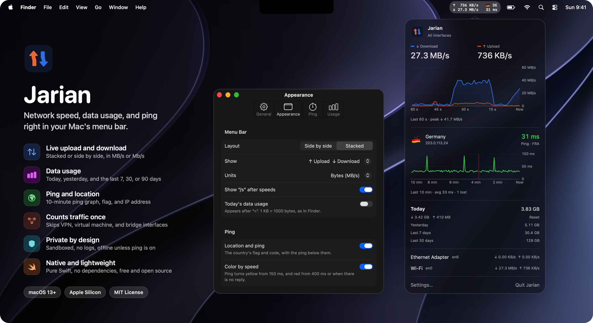

<div align="center">

# Jarian: network speed monitor for the Mac menu bar

**See your upload and download speed, data usage, and ping at a glance. Free, open source, and private.**


</div>

<p align="center">
  
</p>

**Jarian** (جریان, Persian for "flow") is a small, native macOS menu bar app that shows your **internet speed** in real time. It's a Mac take on the popular GNOME *Internet Speed Monitor* extension. It shows what you'd want to know about your connection, and it doesn't watch you.

## Why Jarian

- ⚡ **Live speed in the menu bar.** Upload and download speed, stacked or side by side, in MB/s or Mb/s.
- 📊 **Data usage tracking.** Today's total, plus yesterday and the last 7, 30, and 90 days.
- 📈 **Speed graph.** The last 60 seconds, plus a per-interface breakdown (Wi-Fi, Ethernet, iPhone tethering).
- 🌍 **Ping and location (optional).** Real latency to Cloudflare, Google, or Apple, a 10-minute ping graph, and the country, IP address, and network operator that websites see. Useful with a VPN.
- 🎯 **Accurate counts.** Skips VPN tunnels, VMs, and virtual interfaces so traffic isn't counted twice, and uses 64-bit counters so totals never wrap.
- 🔒 **Private by design.** Runs in the App Sandbox, keeps no logs, and makes no network requests unless you turn on ping.
- 🪶 **Lightweight.** Pure Swift with no third-party dependencies. Launches at login if you want it to.

## Install

Requires macOS 13 Ventura or later on Apple Silicon, and the Xcode Command Line Tools (`xcode-select --install`).

```sh
git clone https://github.com/devbymak/jaryan.git && cd jaryan
./build.sh --install
```

This builds Jarian, copies it to `/Applications`, and opens it. Look for the speed readout in your menu bar. Click it for details, or right-click it for quick options.

## Privacy

With ping off (the default), Jarian has **no network access** of its own. It only reads your Mac's interface counters. With ping on, it contacts only the ping server and location service you choose, sends no cookies and a generic user agent, and caps every reply. On disk it keeps only your preferences and one total per day (at most 90 days). The App Sandbox blocks it from reading your files or accepting incoming connections.

<details>
<summary><b>For developers</b></summary>

```sh
./test.sh    # run the tests
./build.sh   # build Jarian.app here without installing it
```

- `Jarian.app/Contents/MacOS/jarian --probe` prints each interface's counters and whether they're counted.
- `--ping` prints ping and location readings for 30 seconds. To pick providers, put `-pingServer google|apple|cloudflare`, `-locationService ipinfo|geojs|ipsb|ifconfig|cloudflare|off`, or `-pingInterval 1|2|5|10|30|60` before it.
- Preferences are stored in `~/Library/Containers/local.jarian`.

The default build is signed ad hoc, so it runs only on the Mac that built it. To share it, sign it with a Developer ID and notarize it:

```sh
JARIAN_SIGN_IDENTITY='Developer ID Application: Your Name (TEAMID)' ./build.sh
ditto -c -k --keepParent Jarian.app Jarian.zip
xcrun notarytool submit Jarian.zip --keychain-profile <profile> --wait
xcrun stapler staple Jarian.app
```

`assets/app-icon.swift` draws the app icon; run `xcrun swift assets/app-icon.swift assets/app-icon.png` to regenerate it. The screenshot uses demo data.

</details>

## License

MIT. See [license](license). Contributions and stars are welcome ⭐
